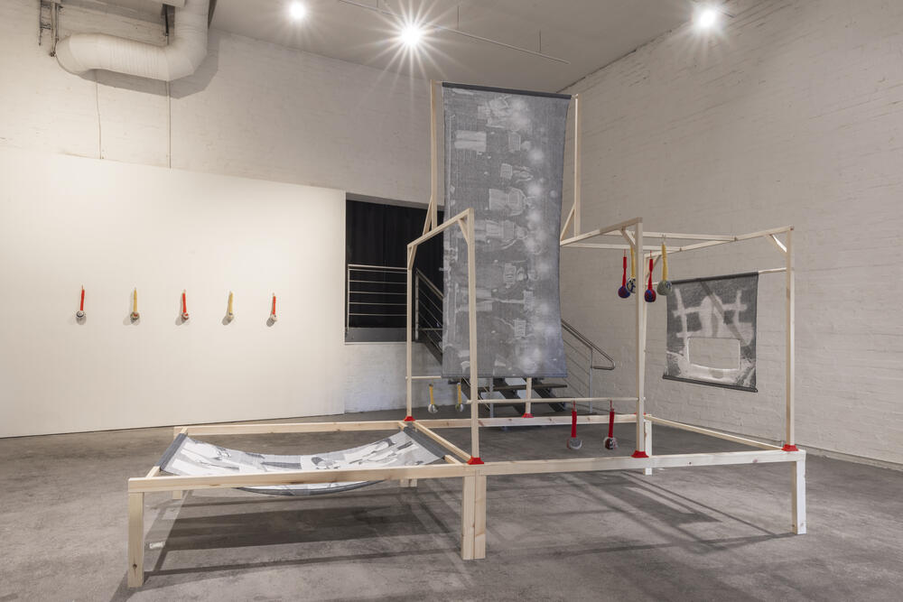
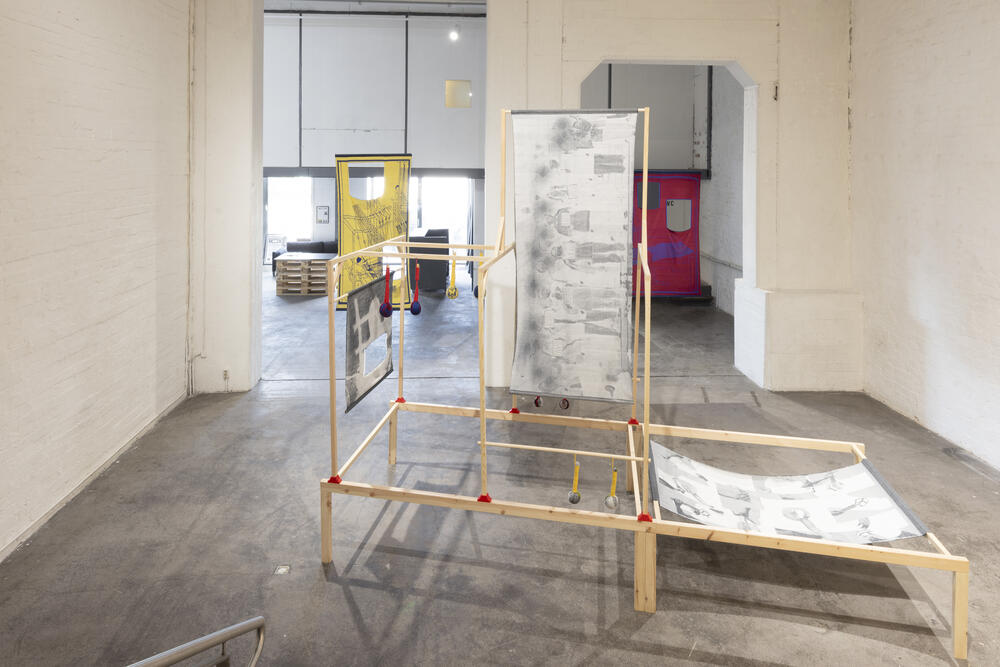
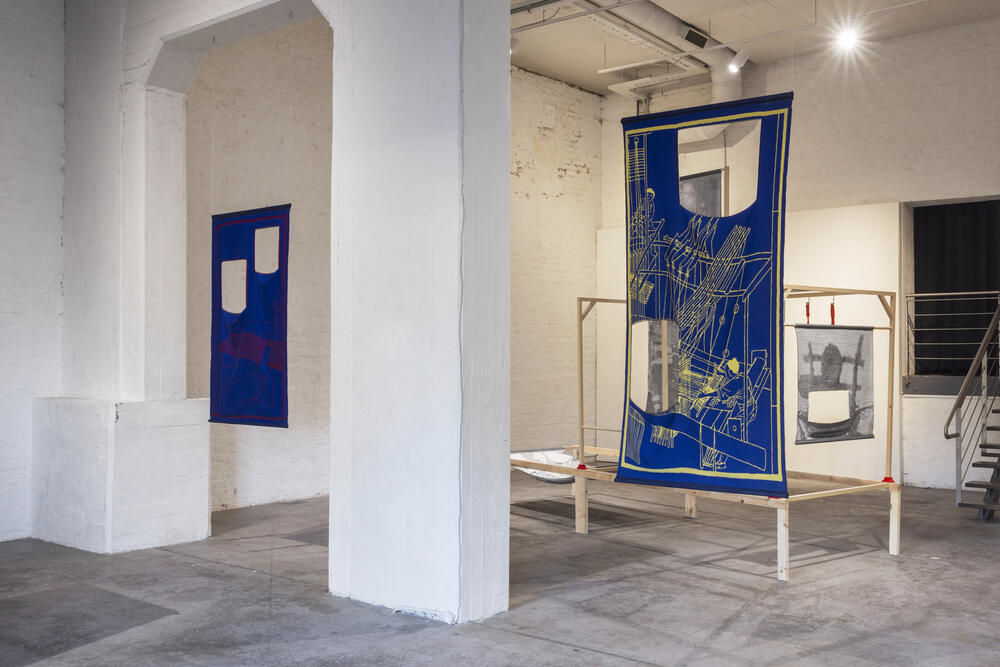
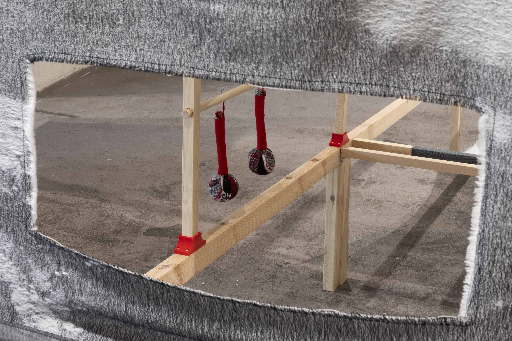
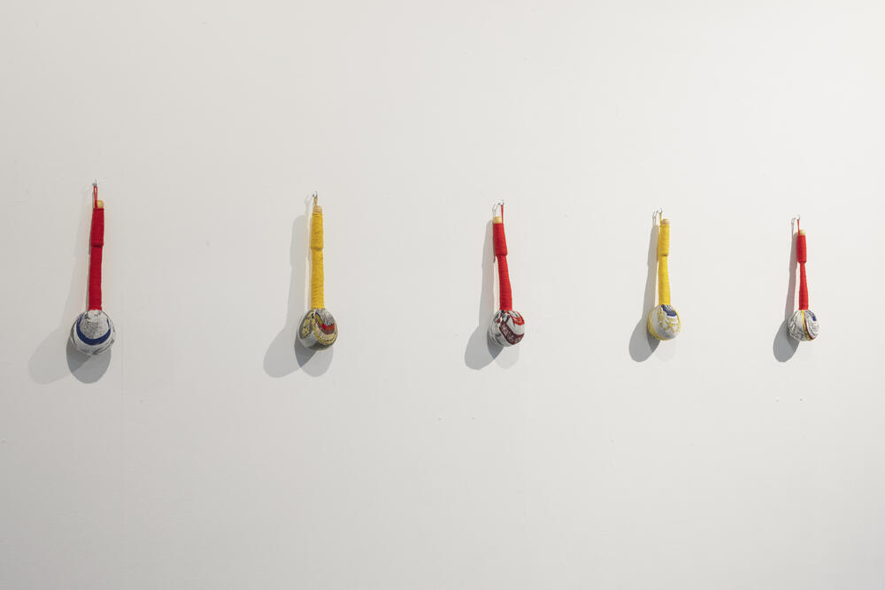
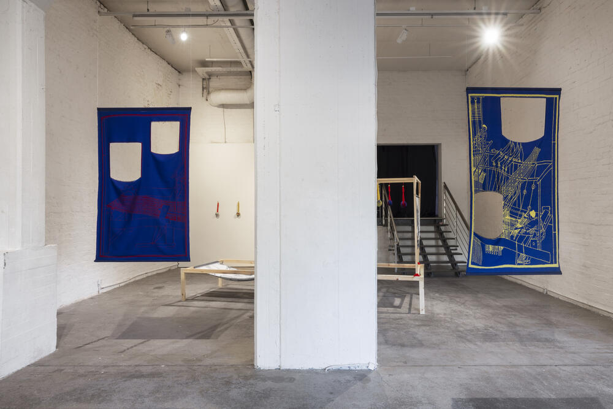

### **Health Hammer**

   
2026    
Handwoven Jacquard Weave, wool and cotton, wood, 3D-printed PLA components, paper, mugwort, cassia seeds, and lavender. 

Tools of protest serve a purpose when crafting a movement. Meanwhile, objects of monument are crafted for remembering, for reminding, and for tending the wounded collective once a movement’s pace halts. In this exhibition, Health Hammer raises a portable monument; an object that documents fragments of events, struggles, and acts of resistance that otherwise cannot be publicly pronounced, mourned, or commemorated.  

The physical health hammer, the ideal portable monument suggested in the exhibition, looks like a self-defense weapon but functions as a tool of self-care. Derived from ordinary life, the health hammer is a manual tool that combines acupressure tapping with herbal aromatherapy to relieve muscle tension and stimulate lymphatic drainage. The hammers encourage a moment for collective healing from the trauma of being concealed, censored, or erased, through the self-performed gesture of massage. One pounds their own body–or another body–with the health hammer until it vibrates, echoes, and reaches resonance with the past, present, and future. 

The fabric wrapping the hammers consists of cut-outs from pieces of larger handwoven Jacquard textiles. While the larger pieces render coded graphics of resistance in action, the cut-out, which becomes a decorative and functional component of a health hammer, traces the fragments of poems, phrases, words, and letters that resisted against the institutional systems of forgetting. Interwoven and inherited, the textiles in the exhibition accompany one another as they resonate through their shared encoded memories.

The installation of exhibition space draws from the structure of the Chinese draw loom, the precursor to the Jacquard loom. Historically, the draw loom was organized in two layers: the draw-boy sat above, controlling the pattern, while the weaver below carried out the physical labor of weaving. This binary system of weaving would later contribute to the development of the Jacquard mechanism and, ultimately, modern computational systems, where languages continue to process through encoding and decoding.

The exhibition treats weaving as an act to reminisce the presence of the voices silenced loud under the authoritarian censorship and utilizes objects of monuments to preserve the censored information in functional form. The Jacquard weave materializes the erasable content into tangible, long-lasting representation, allowing the continuation of its impact and legacy of documenting the truth. Sincerely, the exhibition wishes to offer the ones who fought with portable monuments that serves as personal remembrance of disobedience and encourages moments of self-regulation and care.

***Health Hammer ***, Installation View at *Health Hammer*, Solo Exhibition at **Forum Box**, Helsinki, Finland, 2026.

Image Credit: Forum Box / Anna Autio, 2026

&nbsp;

