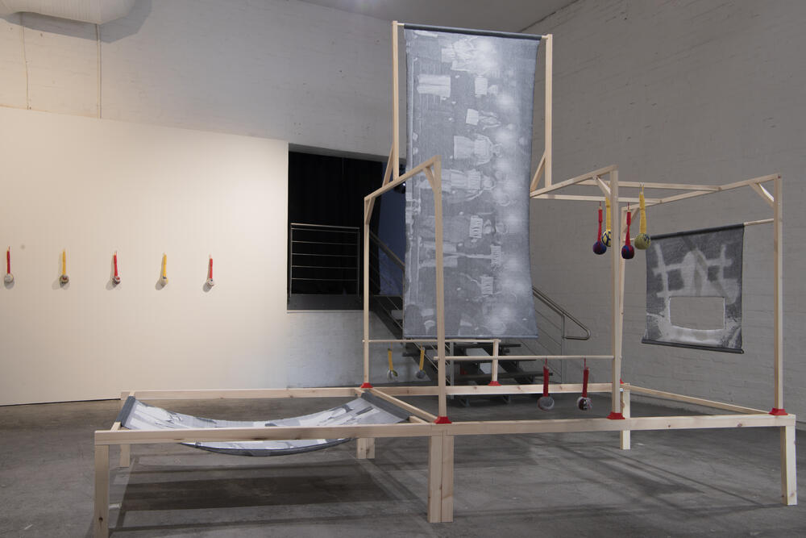
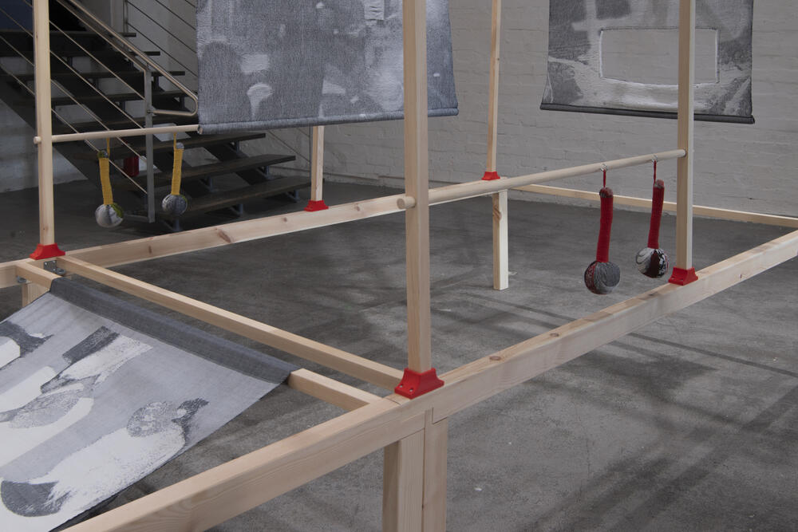
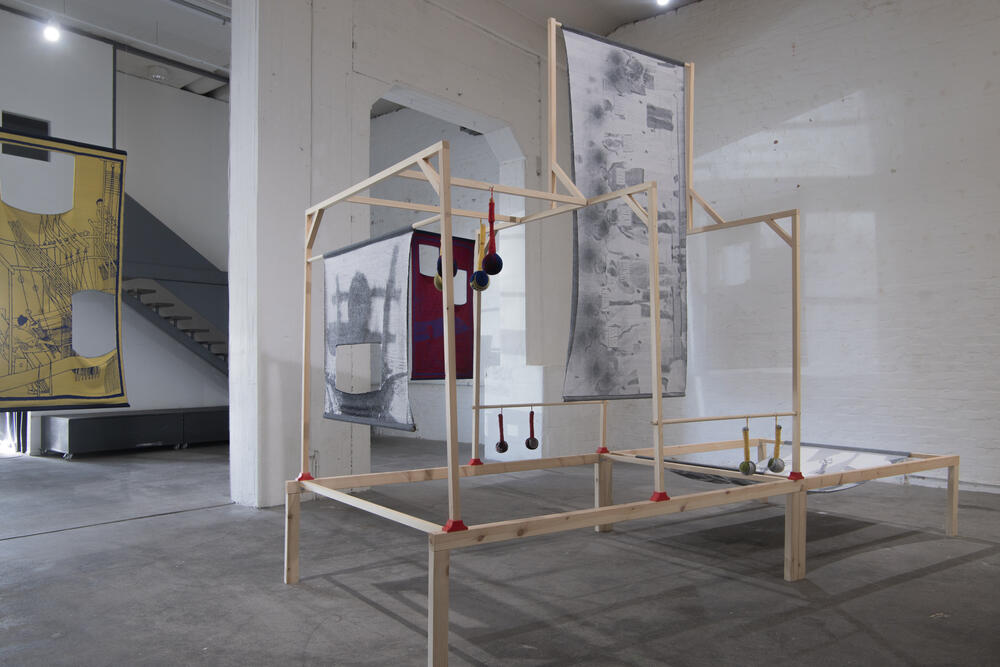
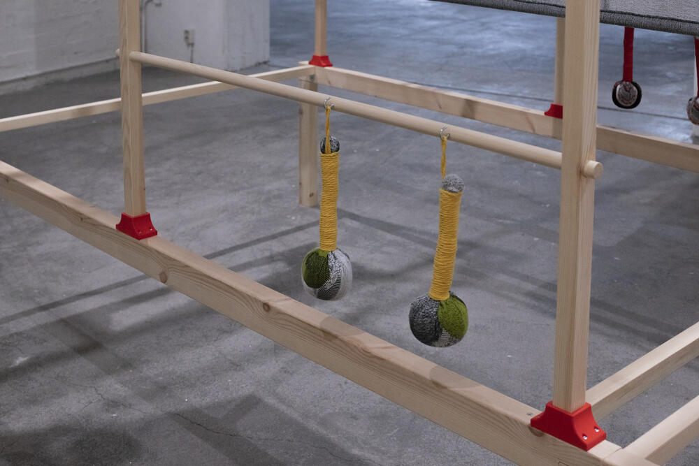

### **Drawloom / Drawperson**

2026, Wood and 3D-printed PLA sockets, 437 × 159 × 265 cm.
Designed by Yujie Zhou. Wooden structure fabrication support by Wudith Woranga.

At the centre of the exhibition, a series of handwoven Jacquard textiles is stretched across a wooden drawloom structure. The structure is inspired by ancient Chinese drawlooms, precursors to the Jacquard loom. In these looms, an assistant was positioned above the loom, perched atop the harnesses and controlling the pattern threads, while the weaver worked below. The woven image therefore depended on two bodies occupying different positions within the same system. Sometimes, the weaver worked for a long time without knowing the complete pattern they were producing. Controlled from above, the image became visible to them only gradually through the labour of weaving.

The Jacquard mechanism later automated this system by transferring pattern control from the drawperson to instructions encoded on punched cards. Within Health Hammer, this history connects Jacquard weaving to broader questions of how bodily movement and historical memory are organised, encoded, and controlled.

***Drawloom / Drawperson ***, Installation View at *Health Hammer*, Solo Exhibition at **Forum Box**, Helsinki, Finland, 2026.

&nbsp;

