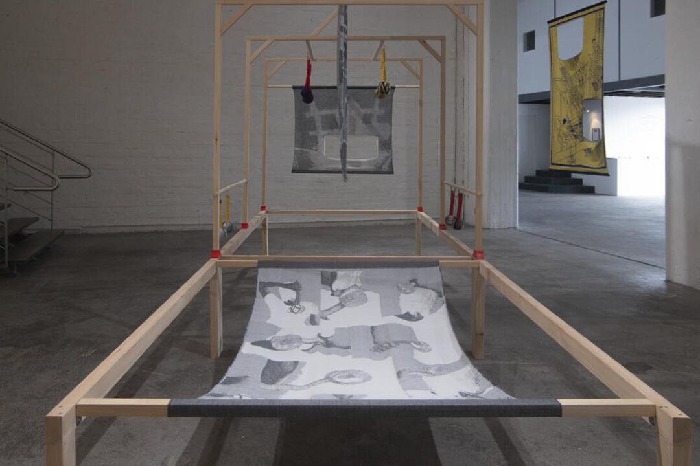
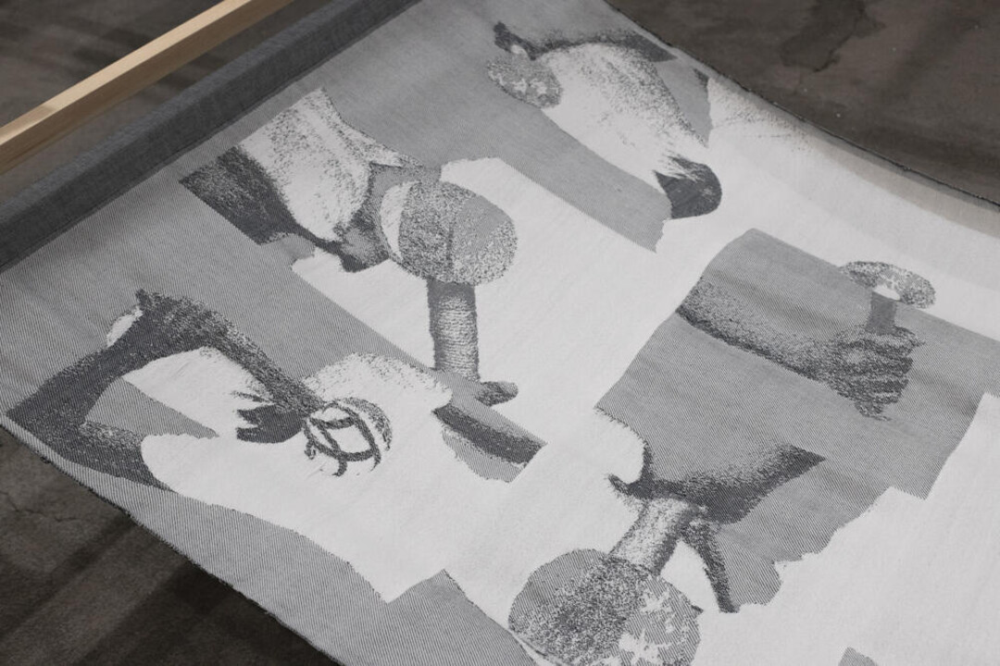
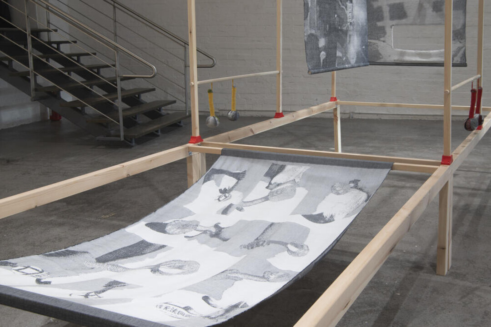
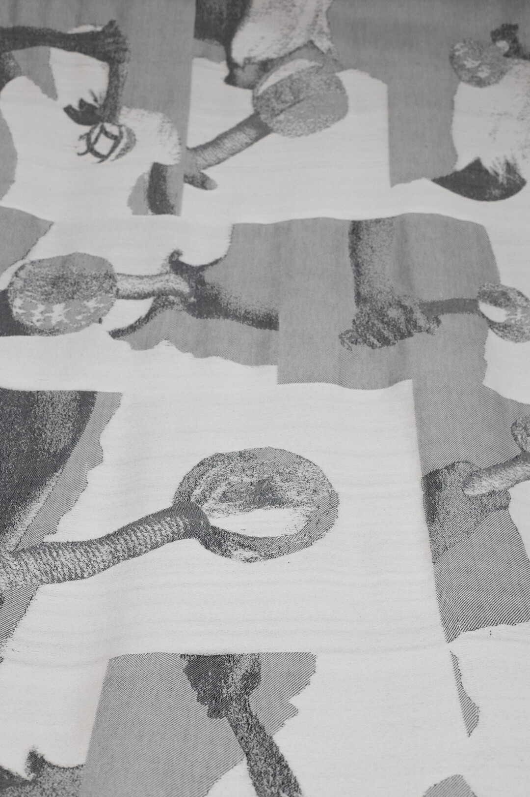

### **Until it Resonates**

2026, Handwoven Jacquard Weave, Wool and Cotton, 100 × 178 cm. Designed and Handwoven by Yujie Zhou. 

*Until it Resonates* functions as an instruction manual for Health Hammer. The handwoven Jacquard textile depicts a sequence of bodies holding and using the hammer, translating gestures of tapping, pressing, carrying, and self-massage into a woven visual score.

Rather than presenting the tool as a static object, the work focuses on how it is activated through repeated bodily movement. The hammer is used on one’s own body or another body until the gesture produces vibration, rhythm, and resonance. Through repetition, the act of massage becomes both a practice of care and a method of remembering.

Installed horizontally within the drawloom structure, the textile resembles a manual, exercise chart, or movement diagram. It connects bodily instruction with the encoded logic of Jacquard weaving, asking how gestures can carry knowledge, memory, and histories that may otherwise remain unspoken.

***Until it Resonates ***, Installation View at *Health Hammer*, Solo Exhibition at **Forum Box**, Helsinki, Finland, 2026.

&nbsp;
