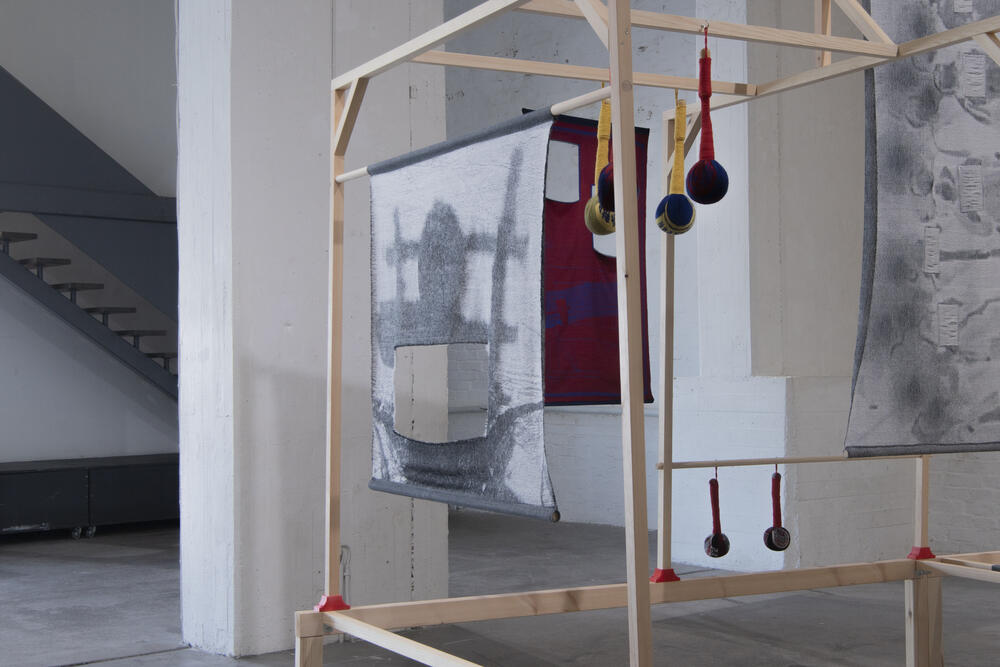
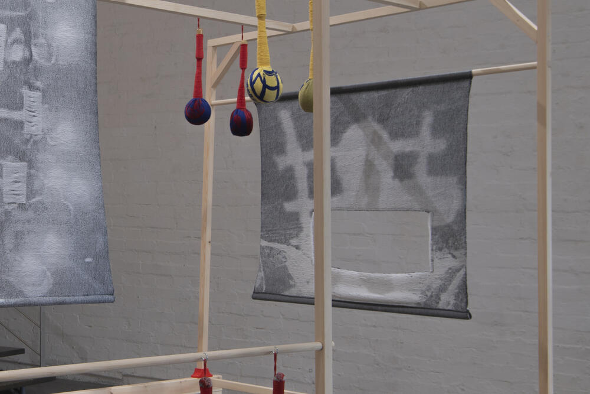
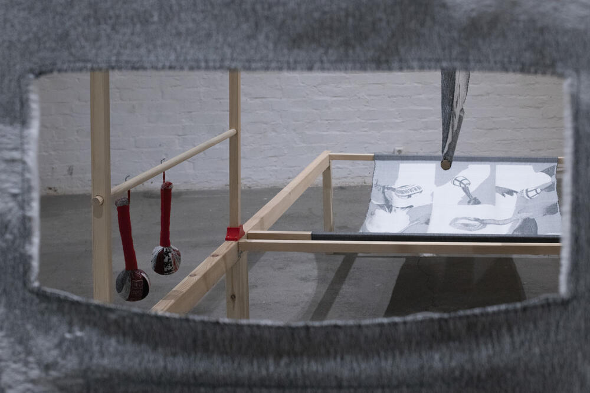
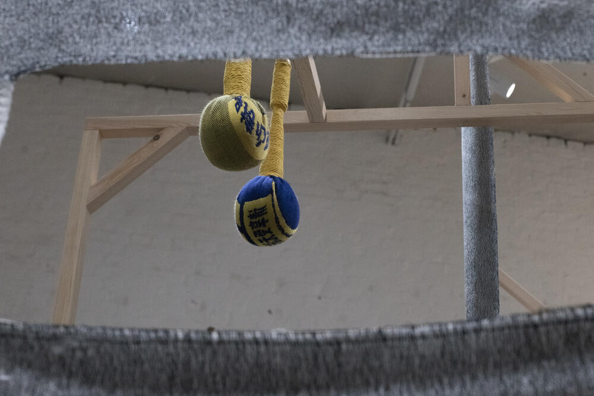

### **This Page Is Intentionally Left Blank**

2026, Handwoven Jacquard Weave, Wool and Cotton, 88 × 100 cm. Designed and Handwoven by Yujie Zhou. 

*This Page Is Intentionally Left Blank* is a handwoven Jacquard textile based on a photograph of my own shadow holding a ladder and attempting to climb upward. In Chinese online culture, a “ladder” is also a colloquial term for tools such as VPNs used to bypass the Great Firewall. The image connects the physical gesture of climbing with the attempt to cross an invisible digital wall.

A large opening is cut from the woven image, allowing viewers to look through the textile and into the surrounding installation. Suspended within the drawloom-inspired structure, the work considers how visibility is controlled, and how acts of looking, climbing, and circumventing can become embodied responses to systems that restrict access to information.

  

***This Page Is Intentionally Left Blank***, Installation View at *Health Hammer*, Solo Exhibition at **Forum Box**, Helsinki, Finland, 2026.

&nbsp;
