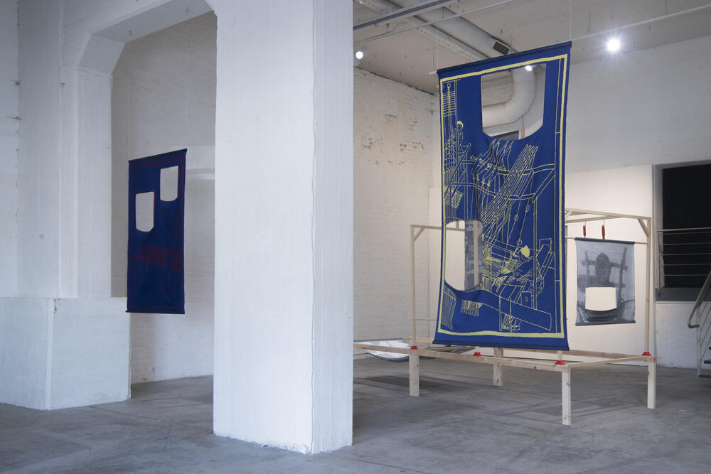
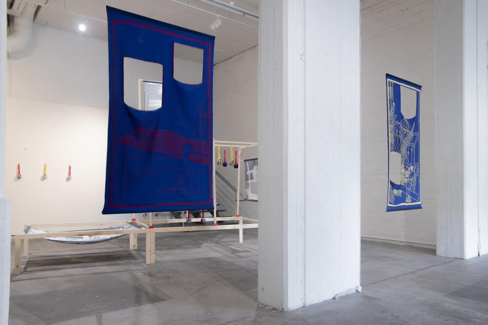
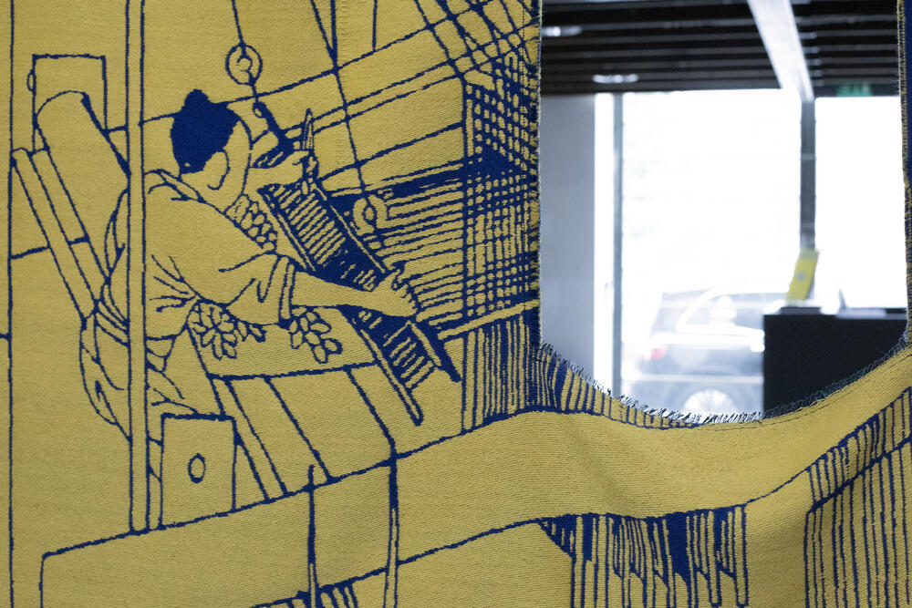
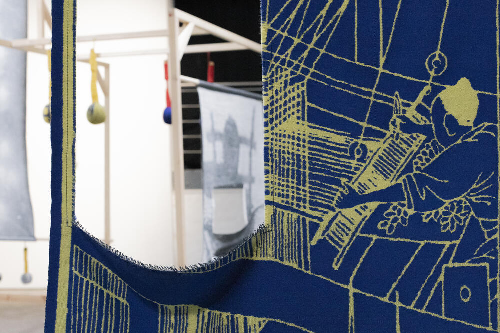
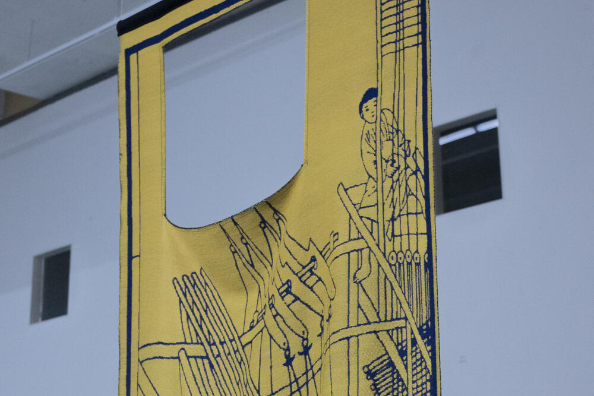
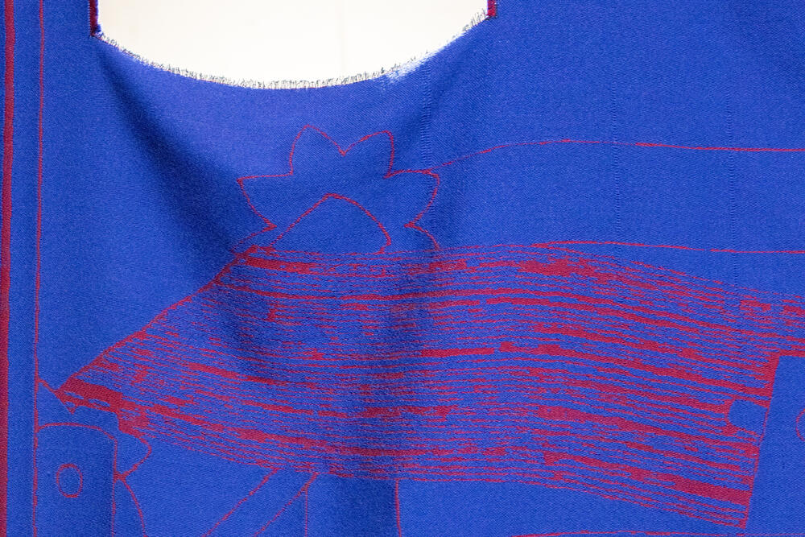
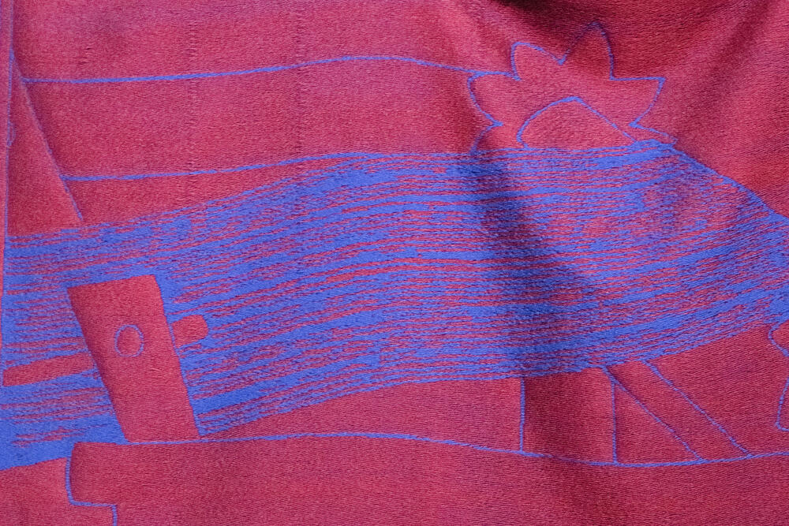

### **Pulling the Flowers**

2026, Handwoven Jacquard weave, wool and cotton, 185 × 100 cm and 160 × 100 cm. Designed and Handwoven by Yujie Zhou.

*Pulling the Flowers* draws from an ancient Chinese drawloom depicted in T’ien-Kung K’ai-Wu, a seventeenth-century treatise on Chinese technology by Song Yingxing. The installation echoes the structure of the drawloom, a precursor to the Jacquard loom, in which weaving was organized across two levels: the drawperson sat above, controlling the pattern threads, while the weaver below carried out the physical labour of weaving.

This division of labour produced the woven image through two bodies occupying different positions within the same system. The pattern was controlled from above while being materially realized through repetitive labour below, creating a relationship between instruction, execution, visibility, and control.

The drawloom later contributed to the development of the Jacquard mechanism, which translated pattern-making into encoded instructions through punched cards. Pulling the Flowers connects this history of textile production to contemporary systems of computation, where information and language continue to be processed through encoding and decoding.

***Pulling the Flowers ***, Installation View at *Health Hammer*, Solo Exhibition at **Forum Box**, Helsinki, Finland, 2026.

&nbsp;
