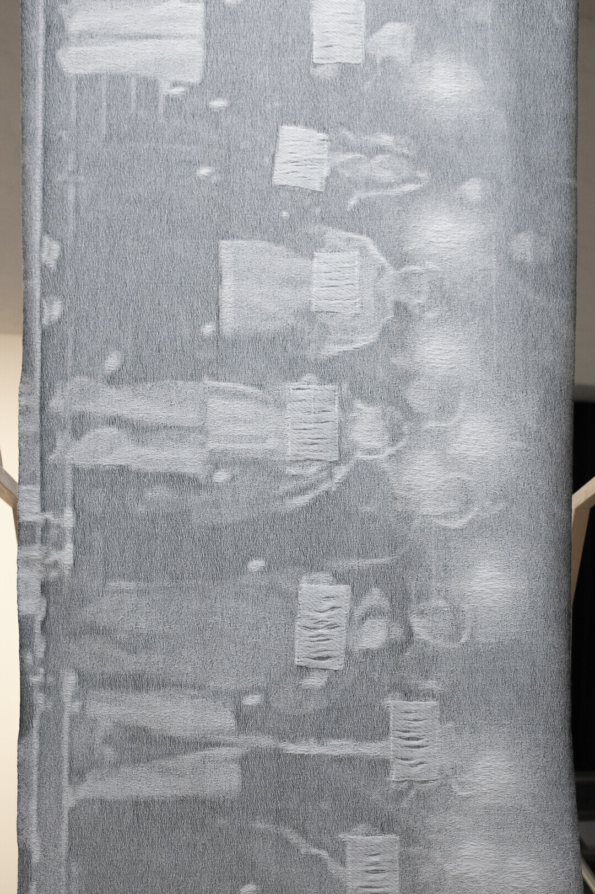
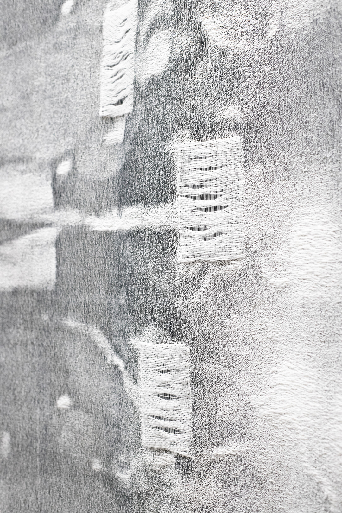
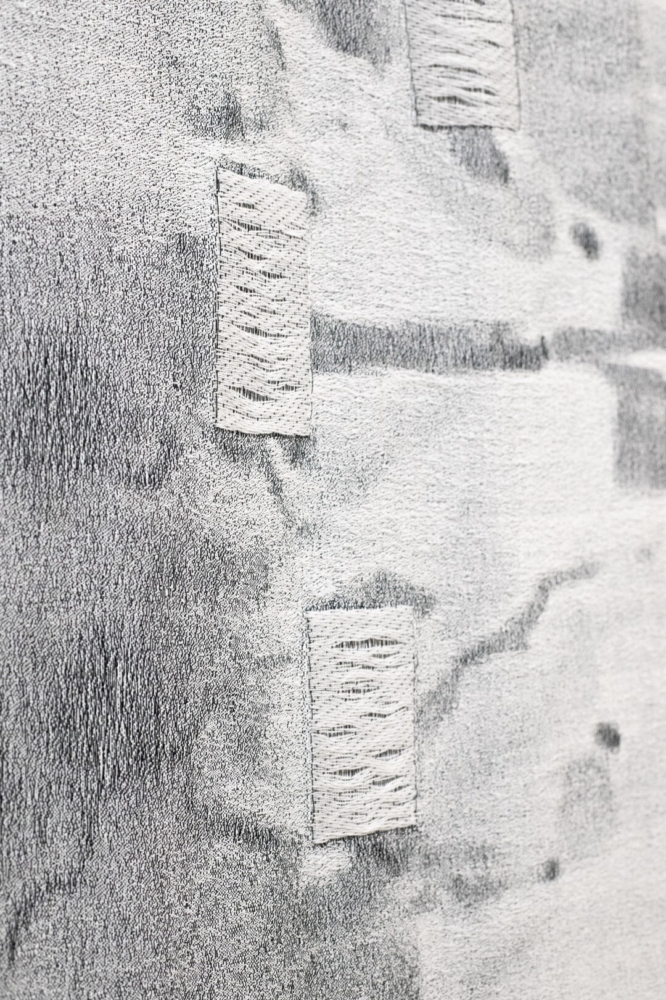

### **The Blank White Paper**

2026, Handwoven Jacquard Weave, Wool, Cotton, and White Paper, 220 × 100 cm. Designed and Handwoven by Yujie Zhou.

*The Blank White Paper* is based on an image from a movement of people holding blank sheets of paper as a form of silent protest. Although the paper carried no written message, its blankness came to signify what could not be publicly spoken, turning absence itself into a form of resistance.

In the textile work, the image is translated into Jacquard weaving. The blank sheets held by the protesters are represented by actual pieces of white paper inserted into woven pockets within the textile and partially concealed behind floating threads. The paper becomes both image and material: blank, yet carrying what cannot be written.

This work is indebted to all those who stood with courage in these moments, whether holding up a blank sheet of paper or not.

  

***The Blank White Paper***, Installation View at *Health Hammer*, Solo Exhibition at **Forum Box**, Helsinki, Finland, 2026.

&nbsp;

