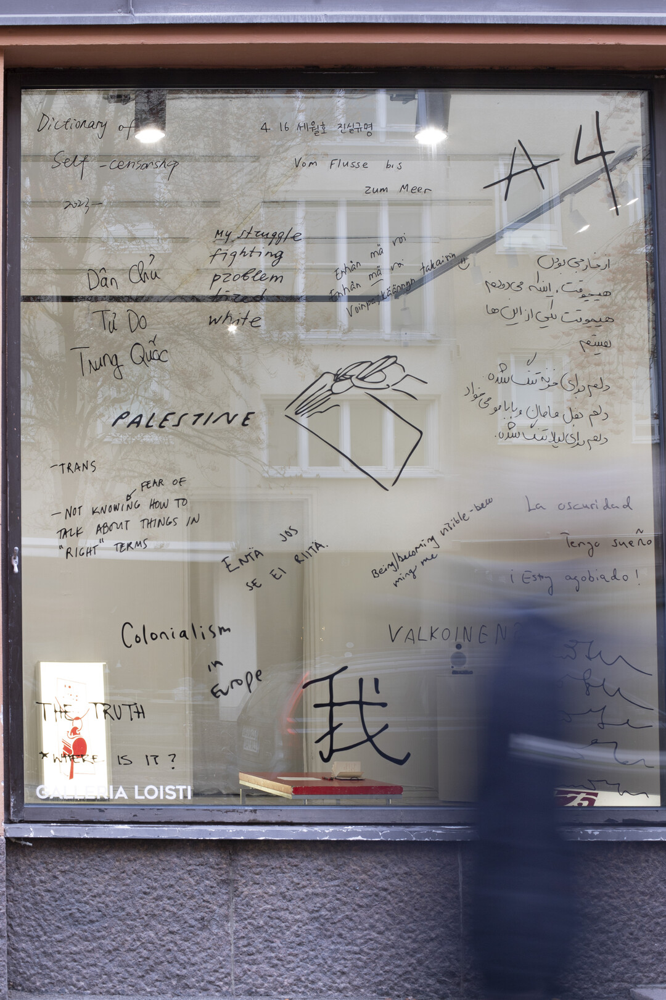
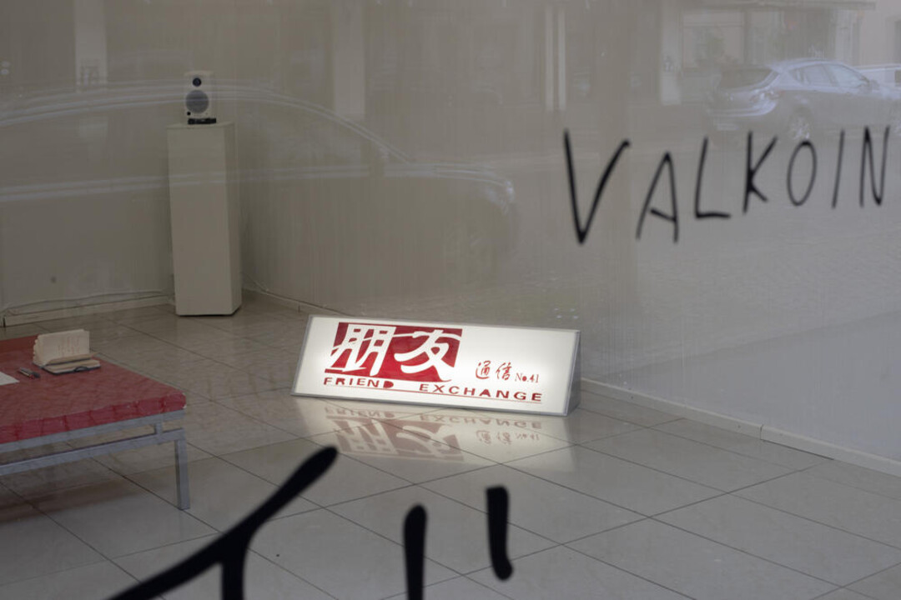
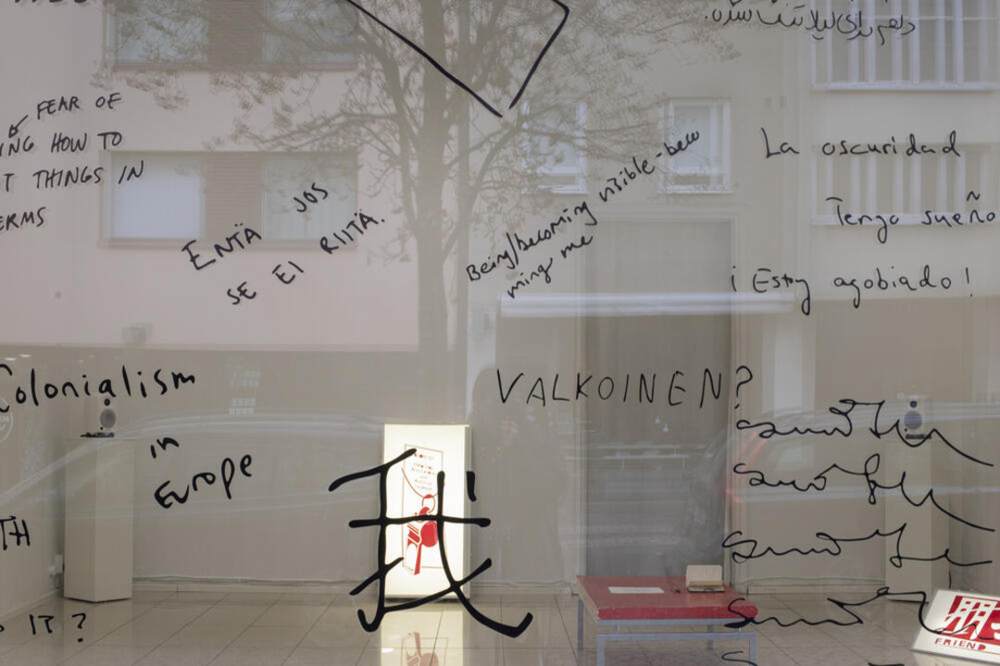
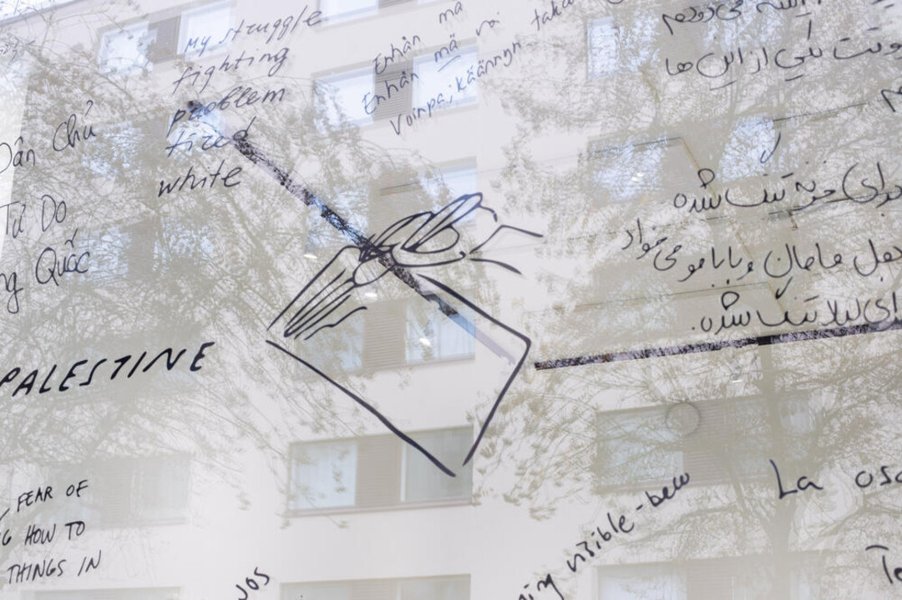
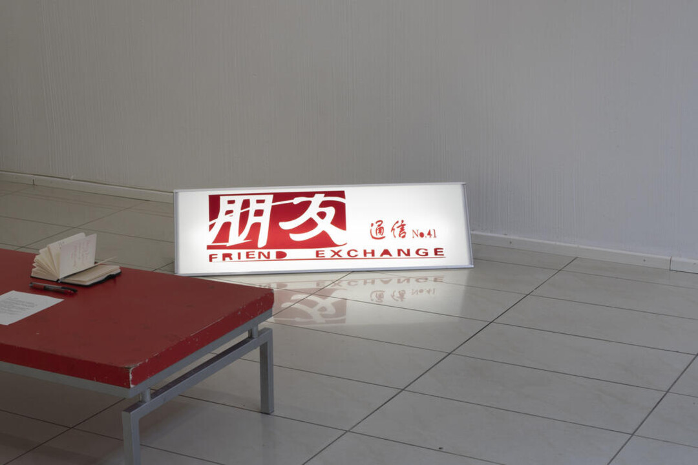
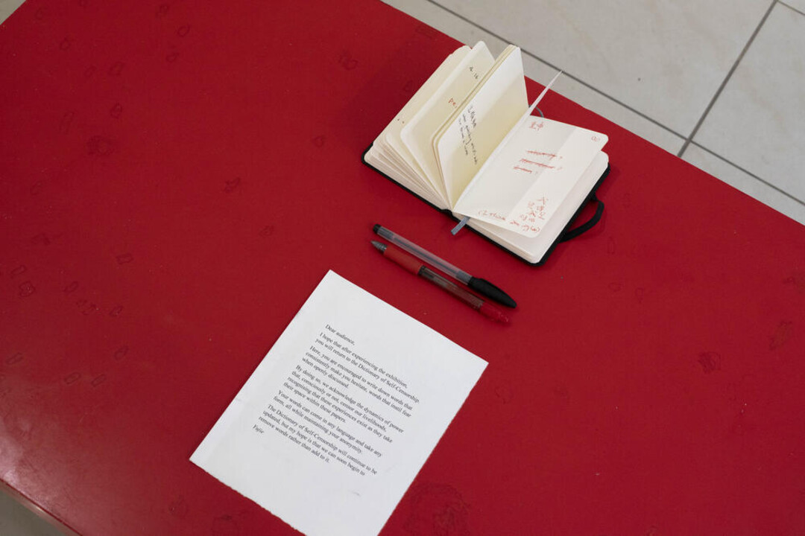
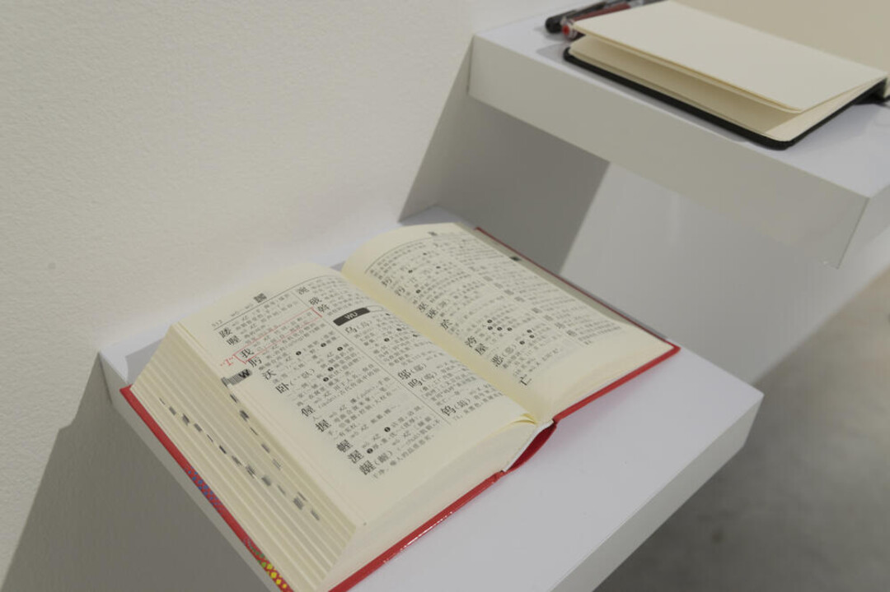

### **Dictionary of Self-Censorship**

2023-2025, Vinyl Cutting , Notebook, Lightbox.

**Dictionary of Self-Censorship** draws inspiration from the word我 (wǒ, meaning “I”) as defined in the Xinhua Dictionary, a fundamental reference for Chinese students learning Mandarin. According to this dictionary, the character 我 (“I”) is linked to three phrases: 我国 (“my country”), 自我批判 (“self-criticism”), and 忘我精神 (“spirit of self-sacrifice”). These associations between the self and collective identity inspired Yujie Zhou to initiate a shared writing process for the Dictionary of Self-Censorship. By opening this private notebook to the public, written across a window facing the street, they aim to make visible some anonymous contributions that make up the Dictionary as of today.

***Dictionary of Self-Censorship ***, Installation View at *~~sorry~~*, **Galleria Loisti**, Helsinki, Finland, 2025.    

&nbsp;

***Dictionary of Self-Censorship ***, Installation View at *QWERTY*, Solo Exhibition at **Photographic Gallery Hippolyte**, Helsinki, Finland, 2023

&nbsp;

  

